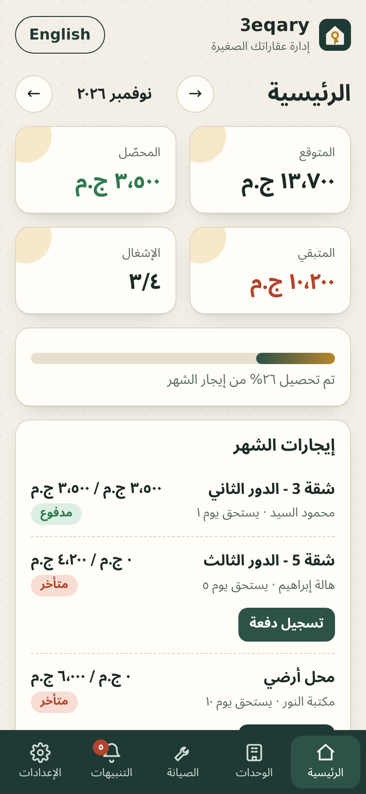
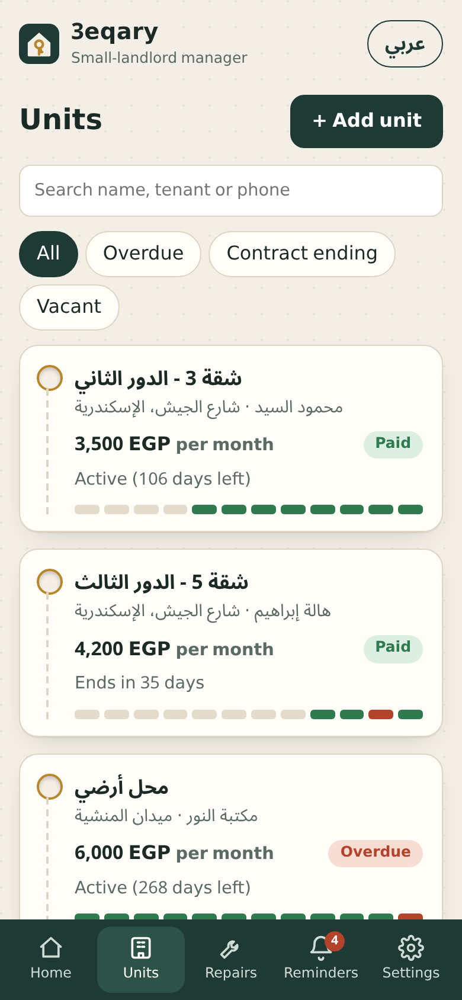

<p align="center"></p>

<h1 align="center">3eqary | عقاري</h1>

<p align="center"><b>Rent status, contract files, repairs and reminders for landlords with a few units.</b><br>
<b>متابعة الإيجارات وملفات العقود والصيانة والتنبيهات لمالك العقار الصغير.</b></p>

<p align="center"><a href="https://yousefkhames.github.io/3eqary/"><b>Live demo &rarr; yousefkhames.github.io/3eqary</b></a></p>

<p align="center"> </p>

## The pitch

If you rent out a few flats or shops, your records live in a notebook and a WhatsApp chat. You forget who paid, when a contract ends, and which leak is still unfixed. 3eqary puts that in one screen on your phone. Add a unit, record the tenant and rent, and it tells you who is late, whose contract ends soon, and what needs fixing. No account, no server.

## Features

- **Dashboard**: expected, collected and outstanding rent for any month, occupancy, and a collection bar.
- **Units as key tags**: tenant, phone, rent, due day, deposit, contract dates, and a 12-month paid/late strip per unit.
- **Rent tracking**: full and partial payments, per-month status (paid, partial, due soon, overdue), arrears across months. Tap an unpaid month in the strip to record it.
- **Printable receipts** for every payment, with your name as landlord.
- **Contract files**: attach a photo or PDF of the contract or ID to each unit; open or delete later.
- **Maintenance**: repair requests with priority, status (open, in progress, done) and cost; spend total.
- **Reminders**: automatic ones (rent due, late, arrears, contract ending or ended, urgent repairs) plus your own. Export to your calendar as an `.ics` file with monthly rent-due events.
- **Search and filters** on units: overdue, contract ending, vacant.
- **Backup and restore** as JSON, payments export as CSV (opens in Excel with Arabic text).
- **Arabic and English**, full RTL layout, mobile first, works on desktop too.

## Run it

It is static files. Open `index.html`, or serve the folder:

```
python3 -m http.server 8099
```

## Tests

```
npm test                                 # 14 unit tests for the logic (Node, no dependencies)
BASE=http://localhost:8099/ node tests/e2e.js   # real Chrome click-through, 31 checks
```

The click-through needs `playwright-core` (set `PW_PATH` if it is installed elsewhere) and a Chrome binary (`CHROME`, default `/usr/bin/google-chrome`). Add `?today=YYYY-MM-DD` to the URL to pin "today" for repeatable runs.

## Tech

Plain HTML, CSS and JavaScript. No framework, no build step, no network calls, no fonts to download. State is one JSON object in `localStorage`. The business rules live in `logic.js` (pure functions, tested in Node); `app.js` only renders and handles clicks.

## Honest limits

- **Data stays in one browser on one device.** There is no sync, no login and no server. Clearing site data erases it. Use Backup regularly.
- **GitHub Pages is a demo host.** For real use, host the files yourself.
- **File attachments are stored inside the browser** and each is limited to 700 KB; the browser allows roughly 5 MB total. Heavy scans will not fit.
- **No automatic notifications.** Reminders show when you open the app; the calendar export is the way to get alerts on your phone.
- Rent logic is monthly with one due day per unit. No late fees, no rent increases, no multi-tenant splits.
- Not accounting or legal software. Receipts are convenience records, not official invoices.

## License

MIT. See [LICENSE](LICENSE).
